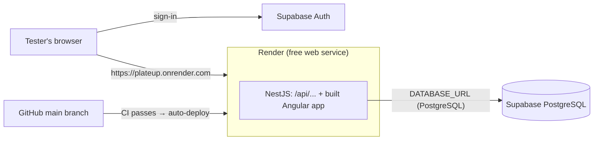

# Deployment

This page is for whoever sets up or maintains the hosting.

- **One Render web service** builds both workspaces and runs `npm start`, which serves the API under `/api` and the Angular app from the same URL. Settings are in [`render.yaml`](../render.yaml) (a Render "Blueprint").
- **One Supabase project** provides the PostgreSQL database.
- **GitHub Actions CI** (`.github/workflows/ci.yml`) checks every push. Render deploys a new commit on `main` only after CI passes on it (`autoDeployTrigger: checksPass`).

## Cost: $0

| Service        | Plan                               | Card required | Limits that matter to us                                                                                                                                            |
| -------------- | ---------------------------------- | ------------- | ------------------------------------------------------------------------------------------------------------------------------------------------------------------- |
| Render         | Free web service (0.1 CPU, 512 MB) | No            | Sleeps after 15 minutes with no visitors; the next visit takes up to about a minute to wake it. 750 free hours per month (more than one service running all month). |
| Supabase       | Free project (500 MB database)     | No            | Pauses after about a week without database activity; it emails the owner first, and a paused project is restored from the dashboard. Data is kept while paused.     |
| GitHub Actions | Free for public repositories       | No            | None for our use.                                                                                                                                                   |

Render's own free PostgreSQL is **not** used: it is deleted 30 days after creation. The app stores no files on Render's disk (photos are stored in the database), so nothing is lost when Render restarts the service.

## One-time setup

### 1. Create the Supabase project

1. Sign in at <https://supabase.com> (free; "Continue with GitHub" works) and click **New project**.
2. Name it `plateup`, set a **database password** (save it in a password manager; you need it in step 5), and choose the region **East US (North Virginia)**, the one closest to the Render region in `render.yaml`. Click **Create new project** and wait a minute or two.
3. Click **Connect** at the top of the project page, choose the **Session pooler** connection string, and copy it. It looks like:
   `postgresql://postgres.<project-ref>:[YOUR-PASSWORD]@aws-0-us-east-1.pooler.supabase.com:5432/postgres`
   Use the session pooler, not the "Direct connection": the direct one needs IPv6, which Render's free tier does not offer.
4. Replace `[YOUR-PASSWORD]` with the database password. If the password contains characters such as `@`, `#`, `/`, or `%`, either reset it to one with only letters and digits (**Project Settings → Database → Reset database password**) or URL-encode those characters. Do **not** add `?sslmode=...`; the backend turns on encryption itself.
5. For sign-in: copy the **Project URL** and the **anon / publishable key** from **Project Settings → API**. Then, under **Authentication → Sign In / Providers → Email**, turn **Confirm email** off. Supabase's built-in email service only sends to members of the Supabase organization, so testers could never confirm their address.

The app creates its table (`entity_records`) on first start. No SQL needs to be run by hand.

### 2. Create the Render service

1. Sign up at <https://render.com> with **GitHub** (free, no card).
2. Render needs permission to read the repository. Because the repository belongs to `max1dyer`, **the repository owner** approves this: in Render, **New → Blueprint**, then **Configure GitHub** and grant access to `max1dyer/PlateUp`.
3. In **New → Blueprint**, pick the `PlateUp` repository and the `main` branch. Render reads `render.yaml` and shows one web service, `plateup`, on the Free plan.
4. Fill in the values Render asks for:
   - `DATABASE_URL`: the connection string from step 1.4.
   - `SUPABASE_URL`, `SUPABASE_ANON_KEY`: the values from step 1.5.

   Render only asks for these when the Blueprint is first created. To change them later, use the service's **Environment** page.

5. Click **Apply**. The first build installs and compiles both workspaces and takes several minutes. Follow it under the service's **Events / Logs**.
6. When it shows **Live**, open the service URL (e.g. `https://plateup.onrender.com`; Render adds a suffix if the name is taken). Share that link in the README and the release document.

### 3. Check that it works

1. `https://<your-service>.onrender.com/api/health` returns `{"status":"ok"}`.
2. The home page loads, and you can log in as `demo-chef` (the demo recipes are added on the first start).
3. Create an account, add a pantry item, then in Render click **Manual Deploy → Restart service**. After the restart, the pantry item is still there (it is stored in Supabase).
4. In Supabase, **Table Editor → entity_records** shows a row for each user, recipe, pantry item, and so on.

## Day-to-day

- **Deploying:** merge a pull request into `main`. When CI passes, Render builds and deploys it automatically, with no downtime if the build fails (the previous version keeps running).
- **Logs:** Render service → **Logs** (startup, errors, `Connected to PostgreSQL`).
- **Rolling back:** Render service → **Events**, then **Rollback** on an earlier deploy (free services can roll back to the two most recent deploys).
- **Data:** Supabase → **Table Editor** or **SQL Editor**. To start over with only the demo data, run `TRUNCATE entity_records;` and restart the Render service.
