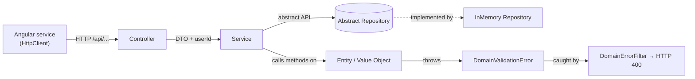
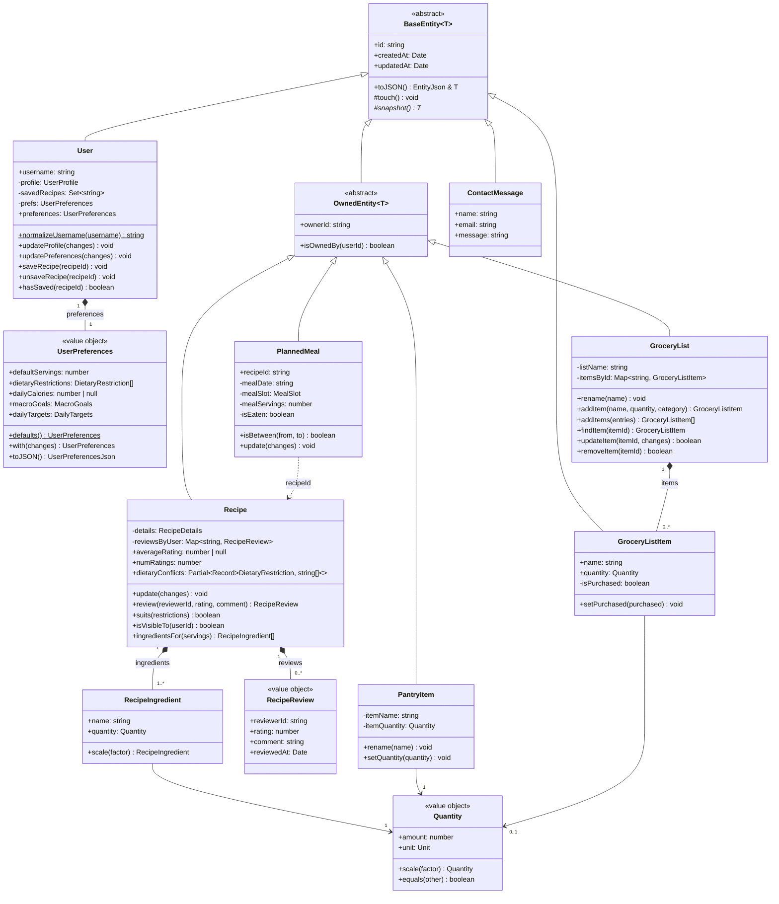

# Design and Architecture

This is the team's living design reference. It is the source for the Interim **Design Approach** paragraph, the **CRC cards**, the **static class diagram**, and the **sequence diagrams**. Keep it in sync with the code: when a domain class, service, or repository is added, renamed, or removed, update this file in the same PR.

---

## Architecture overview

PlateUp has three tiers ([`sprint4.md` Part 4](sprint4.md)):

- an **Angular** single-page app in the browser
- a **NestJS** application server exposing a REST API
- a database (planned: Supabase/PostgreSQL; currently in-memory), plus external services (Supabase Auth, Kroger, USDA FoodData Central, API Ninjas)

The backend is organized into **feature modules** (`users`, `recipes`, `pantry`, `grocery-lists`) that share building blocks in `common/`. Every request passes through the same four layers:

The frontend mirrors this split: each feature folder (`recipes`, `pantry`, `grocery-list`, `users`, `preferences`, `home`) has page components, small child components, and one `HttpClient` service. Cross-cutting pieces live in `app/core/`: `SessionService` (who is signed in), `AuthService` (sign in/out, restore a remembered session), `userIdInterceptor` (adds the user header to every `/api` call), `signedInGuard` (sends visitors to `/login`), and `ToastService` (confirmation messages).

| Layer          | Responsibility                                                                   | Must not                                     |
| -------------- | -------------------------------------------------------------------------------- | -------------------------------------------- |
| Controller     | Map an HTTP route to one service call; identify the user with `@CurrentUserId()` | Contain business logic or touch repositories |
| Service        | Coordinate a use case: load, call entity methods, save; enforce ownership        | Re-implement rules that belong to an entity  |
| Repository     | Store and query aggregates behind an abstract class                              | Contain business rules                       |
| Entity / Value | Hold state privately and enforce every invariant                                 | Depend on NestJS or HTTP                     |

---

## SOLID

| Principle                 | How we apply it                                                                                                                                                                                                   |
| ------------------------- | ----------------------------------------------------------------------------------------------------------------------------------------------------------------------------------------------------------------- |
| **S**ingle Responsibility | Controllers route, services coordinate, repositories store, and entities enforce rules. `DomainErrorFilter` only translates errors. `Quantity` only does unit arithmetic.                                         |
| **O**pen/Closed           | A database is added by writing a new `Repository` subclass, without modifying services. New entities reuse `BaseEntity.toJSON()` by implementing `snapshot()`. Planned import parsers are new classes, not edits. |
| **L**iskov Substitution   | Any `RecipeRepository` implementation (in-memory, database, or test fake) can replace another without the service noticing. Every `OwnedEntity` can be ownership-checked the same way.                            |
| **I**nterface Segregation | Each feature repository adds only the queries its service needs (`findVisibleTo`, `findByOwner`, `findByUsername`) on top of a minimal four-method base.                                                          |
| **D**ependency Inversion  | Services depend on abstract repository classes, and modules bind the concrete class (`{ provide: RecipeRepository, useClass: InMemoryRecipeRepository }`).                                                        |

---

## Design patterns

Every pattern listed here is annotated in the source with a `@pattern` TSDoc tag ([`CODING_STANDARDS.md` 4](CODING_STANDARDS.md#4-documentation-conventions)).

### Implemented

| Pattern                     | Participants                                                                                                                 | Why we use it                                                                                                                             |
| --------------------------- | ---------------------------------------------------------------------------------------------------------------------------- | ----------------------------------------------------------------------------------------------------------------------------------------- |
| **Dependency Injection**    | Every service and controller constructor. Module `providers` bind abstract repository tokens to implementations.             | Decouples consumers from concrete classes. This lets us swap in-memory storage for a database, and lets tests substitute fakes and mocks. |
| **Template Method**         | `BaseEntity.toJSON()` (template method) calls the abstract `snapshot()` (primitive operation), which each entity implements. | Every entity serializes with identical id and timestamp handling while keeping its fields private.                                        |
| **Mock Objects**            | Controller specs (`jest.fn()` services), frontend component specs (`vi.fn()` services), `HttpTestingController`.             | Tests one class in isolation, without HTTP, storage, or other features.                                                                   |
| **Adapter**                 | `DomainErrorFilter` adapts `DomainValidationError` (domain) to an HTTP 400 response (Nest/Express).                          | Keeps the domain layer framework-free.                                                                                                    |
| **Singleton**               | Nest providers (default singleton scope); Angular services with `providedIn: 'root'`.                                        | One shared repository instance per app, so all services see the same data.                                                                |
| **Chain of Responsibility** | Angular HTTP interceptors (`userIdInterceptor` in `app/core/`); Nest's exception-filter chain.                               | Cross-cutting request handling without modifying each service.                                                                            |

Other techniques (not on the course list): **Repository**, **Value Object** (`Quantity`, `RecipeIngredient`, `RecipeReview`, `UserPreferences`), and **Aggregate Root** (`GroceryList` owns its `GroceryListItem`s).

### Planned (Beta)

| Pattern                           | Feature                                                                                                                                | Notes                                                                                                                                                        |
| --------------------------------- | -------------------------------------------------------------------------------------------------------------------------------------- | ------------------------------------------------------------------------------------------------------------------------------------------------------------ |
| **Strategy**                      | Grocery-list generation: "add all ingredients" vs. "add only what the pantry is missing" (user setting); recipe sorting and filtering. | A `GroceryGenerationStrategy` interface with one class per policy, chosen at run time from user preferences.                                                 |
| **Factory Method** + **Strategy** | Social-media import (TikTok, Instagram, YouTube Shorts).                                                                               | Spec 3.5 requires that a new platform needs only one new parser module. Use a `RecipeTextParser` interface and a factory that picks the parser for a source. |
| **Observer**                      | Household shared grocery list (live updates within 2 s).                                                                               | WebSocket gateway publishes list changes. The Angular client subscribes through an RxJS `Observable`.                                                        |
| **Facade** + **Proxy**            | External API clients (Kroger, USDA, API Ninjas).                                                                                       | A facade gives one interface over all external calls. A caching proxy handles caching and the shared 15-second timeout.                                      |
| **Null Object**                   | Missing price or nutrition data.                                                                                                       | Lets calculations continue and label figures as unavailable (Reliability 3.3).                                                                               |

---

## Class inventory

These are the major classes for CRC cards and the class diagram. Paths are relative to `backend/src/`.

| Class                                                                                                      | Kind                  | Path                                       |
| ---------------------------------------------------------------------------------------------------------- | --------------------- | ------------------------------------------ |
| `BaseEntity<T>`                                                                                            | abstract entity       | `common/domain/base.entity.ts`             |
| `OwnedEntity<T>`                                                                                           | abstract entity       | `common/domain/owned.entity.ts`            |
| `Quantity`                                                                                                 | value object          | `common/domain/quantity.ts`                |
| `DomainValidationError`                                                                                    | error                 | `common/errors/domain-validation.error.ts` |
| `DomainErrorFilter`                                                                                        | exception filter      | `common/filters/domain-error.filter.ts`    |
| `Repository<T>` / `InMemoryRepository<T>`                                                                  | persistence           | `common/persistence/`                      |
| `User`, `UserPreferences`, `UsersService`, `UsersController`, `UserRepository`                             | users feature         | `users/`                                   |
| `Recipe`, `RecipeIngredient`, `RecipeReview`, `RecipesService`, `RecipesController`, `RecipeRepository`    | recipes feature       | `recipes/`                                 |
| `PantryItem`, `PantryService`, `PantryController`, `PantryItemRepository`                                  | pantry feature        | `pantry/`                                  |
| `GroceryList`, `GroceryListItem`, `GroceryListsService`, `GroceryListsController`, `GroceryListRepository` | grocery-lists feature | `grocery-lists/`                           |
| `ContactMessage`, `ContactService`, `ContactController`, `ContactMessageRepository`                        | contact feature       | `contact/`                                 |
| `PlannedMeal`, `PlannerService`, `PlannerController`, `PlannedMealRepository`                              | planner feature       | `planner/`                                 |
| `DemoDataSeeder`, `SeedModule` (TEMPORARY: sample data loaded at startup)                                  | seed data             | `seed/`                                    |

DTOs (`CreateRecipeDto`, `LogInDto`, `AddRecipeToListDto`, ...) are plain request shapes in each feature's `dto/` folder and are not part of the diagram. `guessCategory()` (`common/domain/ingredient-category.ts`) is a pure function that files generated grocery items under a store section. `dietaryConflicts()` and the `DietaryRestriction` enum (`common/domain/dietary-restriction.ts`) are pure keyword rules that estimate which dietary restrictions a recipe's ingredients break; `Recipe` exposes the result as `dietaryConflicts` and `suits()`. `deriveDailyTargets()` (`users/entities/user-preferences.ts`) fills in the one daily goal the others determine (total calories from three gram goals, or the last macro's grams from the calorie goal); the frontend's `planMacros()` (`preferences/macro-plan.ts`) applies the same rule to preview it on the Preferences page and to flag macros that overshoot the calorie goal.

Frontend classes (paths relative to `frontend/src/app/`). Services, models, and helpers sit at the top of each feature folder; each component has its own subfolder named after it (e.g. `recipes/recipe-page/recipe-page.ts`):

| Class                                                                                     | Kind             | Path                        |
| ----------------------------------------------------------------------------------------- | ---------------- | --------------------------- |
| `SessionService`, `AuthService`, `ToastService`, `userIdInterceptor`, `signedInGuard`     | core services    | `core/`                     |
| `UsersService`, `LoginPage`, `ProfilePage`, `ProfileEditForm`                             | users / accounts | `users/`                    |
| `PreferencesService`, `PreferencesPage`                                                   | preferences      | `preferences/`              |
| `RecipesService`, `SavedRecipesService`, `RecipeListPage`, `RecipePage`, `RecipeFormPage` | recipes          | `recipes/`                  |
| `SavedRecipesPage`, `RecipeCard`, `SaveButton`, `AddToGroceryPanel`, `ReviewForm`         | recipes          | `recipes/`                  |
| `PantryService`, `PantryPage`, `PantryItemRow`                                            | pantry           | `pantry/`                   |
| `GroceryListsService`, `GroceryListPage`, `GroceryItemRow`, `AddItemsForm`                | grocery lists    | `grocery-list/`             |
| `ContactService`, `ContactPage`                                                           | contact          | `contact/`                  |
| `HomePage`, `InfoPage`, `SiteHeader`, `SiteFooter`, `ToastOutlet`                         | shell and layout | `home/`, `info/`, `layout/` |

### Domain class diagram (draft)

This draft is generated from the source. Refine it into the final UML class diagram (for example in draw.io or StarUML) before the Interim deadline.

---

## Sequence diagram candidates

Candidates from the source code:

1. **UC6 Generate Grocery List** (Interim scope: one recipe at a chosen serving size). `POST /grocery-lists/:listId/recipes` → `GroceryListsController.addRecipe` → `GroceryListsService.addRecipe` → `GroceryListsService.findOne` (ownership) → `RecipesService.findOne()` (visibility) → `Recipe.ingredientsFor(servings)` → `RecipeIngredient.scale()` → `Quantity.scale()` → drop ingredients named in `excludeIngredients` (`isSameIngredient`) → `guessCategory()` per remaining ingredient → `GroceryList.addItems()` (checks every entry first, then `addItem()` each, combining matches with `Quantity.plus`) → `GroceryListRepository.save()`. In the browser: `RecipePage` (servings stepper; `PantryService.getItems` pre-marks owned ingredients ✓, which the user can toggle) → `AddToGroceryPanel` (target list picked up front; one "Add _n_" button excludes the ✓ ingredients) → `GroceryListsService.addRecipe(…, excludeIngredients)` → toast, staying on the recipe page.
2. **Move Grocery Items to Pantry** (cross-feature: grocery-lists → pantry through the exported `PantryService`, never `PantryItemRepository`). Per item: `GroceryItemRow` "Move to Pantry" (saves unsaved edits first) → `POST /grocery-lists/:listId/items/:itemId/pantry` → `GroceryListsController.moveItemToPantry` → `GroceryListsService.moveItemToPantry` → `findOne` (ownership) → `GroceryList.findItem` → `PantryService.add` (combines with a matching pantry item; refuses an item with no amount or an incompatible unit with `DomainValidationError` → 400, list unchanged) → `GroceryList.removeItem` → `GroceryListRepository.save()`. For checked items: `GroceryListPage` "Move to Pantry" → `POST /grocery-lists/:listId/purchased-items/pantry` → `GroceryListsService.movePurchasedToPantry`, which moves each one the same way and returns `{ list, moved, skipped }` so refused items stay on the list with their reason shown.
3. **UC5 Add Ingredient to Pantry**, including merging an existing ingredient in a compatible unit (`PantryService.add` → `PantryItemRepository.findByOwner` → `PantryItem.canAddQuantity` → `Quantity.plus`).
4. **UC3 Upload Recipe**, including the validation failure path (`RecipeFormPage` → `RecipesService.createRecipe` → `RecipesController.create` → `RecipesService.create` → `Recipe` constructor → `requireText` throws `DomainValidationError` → `DomainErrorFilter` → 400 → message shown in the form).
5. **UC23 Save Recipe** (`SaveButton` → `SavedRecipesService.toggle` → `UsersService.saveRecipe` → `PUT /users/me/saved-recipes/:id` → `UsersService.saveRecipe` → `RecipesService.findOne` (visibility) → `User.saveRecipe` → `UserRepository.save` → `SessionService.setUser`).
